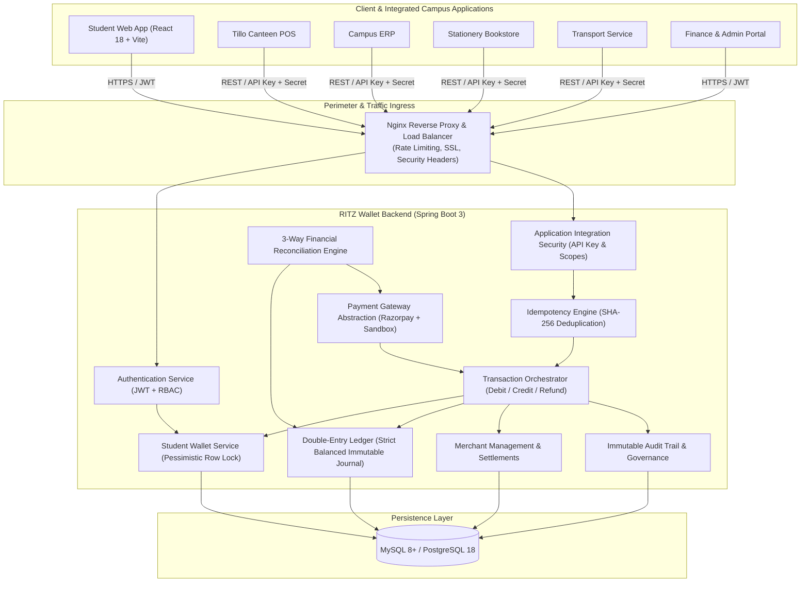

# 🎓 RITZ Wallet — Centralized Campus Digital Wallet & Financial Accounting Infrastructure
### **Rajalakshmi Institute of Technology (RIT)**

[](https://openjdk.org/)
[](https://spring.io/projects/spring-boot)
[](https://react.dev/)
[](https://www.typescriptlang.org/)
[](https://tailwindcss.com/)
[](https://www.mysql.com/)
[](https://www.postgresql.org/)
[](https://www.docker.com/)

---

## 📌 Executive Summary

**RITZ Wallet** is the central financial transaction and stored-value platform engineered for Rajalakshmi Institute of Technology (RIT). It unifies payment processing across all college digital services:
* 🍔 **Tillo POS** — Campus cafeteria and canteen ordering counters
* 📚 **Stationery Management** — Bookstore, uniform store, and printing kiosks
* 🚌 **Transport Management** — Campus bus passes and transit fare management
* 🏛️ **Campus ERP** — Student fee handling, club subscriptions, and administrative payments

### 🛡️ Non-Negotiable Core Principle
> **No external campus application is ever permitted to directly modify a student's wallet balance.**  
> Every transaction MUST flow through RITZ Wallet REST APIs, where it undergoes cryptographic credential verification, permission scoping, pessimistic row-level concurrency locking, SHA-256 idempotency deduplication, and an immutable double-entry ledger.

---

## 🏛️ System Architecture



---

## 👥 User Roles & Seeded Demo Personas

RITZ Wallet implements fine-grained Role-Based Access Control (RBAC). The following personas are seeded automatically on first boot:

| Role | Username | Password | Purpose & Capabilities |
|---|---|---|---|
| **STUDENT** | `RIT2026001` | `StudentPass2026!` | View wallet balance (600 tokens initial), recharge, receipts, refund requests. |
| **SUPER_ADMIN** | `superadmin` | `RitzAdmin2026!` | System governance, wallet freeze/reactivate, application approvals, audit logs. |
| **FINANCE_ADMIN** | `financeadmin` | `RitzFinance2026!` | Double-entry ledger browser, 3-way reconciliation console, CSV export, settlements. |
| **MERCHANT_ADMIN** | `tilloadmin` | `TilloPass2026!` | Merchant sales dashboard, transactions, settlement requests, POS analytics. |
| **APP_DEVELOPER** | `developer` | `RitzDev2026!` | Register campus apps, rotate API credentials, manage scopes, sandbox runner. |

*Quick Persona Switcher:* The web UI at `http://localhost:8085` provides an instant role-switching banner in the header to preview every persona without manual logouts.

---

## ⚡ Quickstart: Local Development & Verification

### 1. Prerequisites
- Java 17 or 21 JDK
- Node.js 20+ & npm
- PostgreSQL 16+ or MySQL 8+

### 2. Run Backend & Frontend in 60 Seconds
```bash
# Clone the repository
git clone https://github.com/rit-chennai/ritz-token-service.git
cd ritz-token-service

# Run all 11 automated unit and integration tests
./mvnw clean test

# Run backend service
./mvnw spring-boot:run
```

Access services:
- 🌐 **Web Application & Dashboards**: [http://localhost:8085](http://localhost:8085)
- 📖 **Interactive Swagger UI**: [http://localhost:8085/swagger-ui.html](http://localhost:8085/swagger-ui.html)
- 🩺 **Health Check**: [http://localhost:8085/actuator/health](http://localhost:8085/actuator/health)
- ⚖️ **Double-Entry Balance Check**: [http://localhost:8085/api/v1/ledger/verify](http://localhost:8085/api/v1/ledger/verify)

---

## 🐳 Production Deployment via Docker Compose

Run the entire stack (MySQL 8.4, Spring Boot backend, and Nginx reverse proxy) with one command:

```bash
# Setup environment file
cp .env.example .env

# Start multi-container stack
docker compose up -d --build

# Verify container health
docker compose ps
```

---

## 🔌 Tillo Canteen Integration SDK

Ready-to-run integration code and SDKs are located in [`examples/tillo-integration/`](examples/tillo-integration/):

### JavaScript / Node.js
```javascript
const { TilloClient } = require('./tilloClient');

const tillo = new TilloClient({
  baseUrl: 'http://localhost:8085',
  apiKey: 'tillo-canteen-app-001',
  apiSecret: 'tillo_live_secret_key_rit2026'
});

// Deduct 80 tokens with automatic idempotency protection
const result = await tillo.debitWallet({
  studentId: 'RIT2024001',
  amount: 80,
  referenceId: 'TILLO-ORD-10023',
  description: 'Lunch Combo Meal',
  merchantCode: 'TILLO'
});
console.log('Debit Success:', result);
```

### Python
```python
from tillo_client import TilloClient

client = TilloClient(
    base_url="http://localhost:8085",
    api_key="tillo-canteen-app-001",
    api_secret="tillo_live_secret_key_rit2026"
)

response = client.debit_wallet(
    student_id="RIT2024001",
    amount=80,
    reference_id="TILLO-ORD-10023",
    description="Lunch Combo Meal"
)
print("Balance remaining:", response["current_balance"])
```

### Java
```java
TilloClient client = new TilloClient("http://localhost:8085", "tillo-canteen-app-001", "tillo_live_secret_key_rit2026");
DebitResponse resp = client.debitWallet("RIT2024001", 80L, "TILLO-ORD-10023", "Lunch Combo Meal", "TILLO");
System.out.println("Remaining Tokens: " + resp.getCurrentBalance());
```

---

## 🧪 Automated Test Suite

The test suite validates financial invariants, concurrency guarantees, and reconciliation:

```bash
./mvnw test
```

| Test Class | Focus Area | Invariant Verified |
|---|---|---|
| `LedgerServiceTest` | Double-Entry Accounting | $\sum \text{Debits} == \sum \text{Credits}$, strictly immutable entries. |
| `ConcurrencyDebitTest` | Race Conditions & Row Locking | 10 parallel threads race for a 100 token balance. Exactly 5 succeed, 5 fail. Zero overdraft. |
| `TransactionServiceTest` | Financial Mutex & Idempotency | Idempotency deduplication, insufficient funds rejection, compensating refunds. |
| `RechargeServiceTest` | Payment Verification | Razorpay HMAC-SHA256 signature verification, rejection of forged signatures. |
| `ReconciliationServiceTest` | 3-Way Reconciliation | Automated cross-audit of Gateway vs Orders vs Authoritative Ledger. |

---

## 📚 Technical Documentation Directory

- 📐 [**System Architecture (`docs/ARCHITECTURE.md`)**](docs/ARCHITECTURE.md) — Modular monolith structure, row-level locking, deadlock prevention, and double-entry invariants.
- 📡 [**REST API Reference (`docs/API_DOCUMENTATION.md`)**](docs/API_DOCUMENTATION.md) — Exhaustive specification for student, partner application, merchant, and finance endpoints.
- 🚀 [**Production Deployment Guide (`docs/DEPLOYMENT_GUIDE.md`)**](docs/DEPLOYMENT_GUIDE.md) — Step-by-step VPS configuration, Nginx SSL (Let's Encrypt), systemd, and database backup scripts.
- ⚖️ [**Financial Reconciliation (`docs/RECONCILIATION.md`)**](docs/RECONCILIATION.md) — 3-way reconciliation mechanics, anomaly classes, and automated audit checks.

---

## 📄 License & Institutional Rights
Engineered exclusively for **Rajalakshmi Institute of Technology (RIT)**. All rights reserved.
