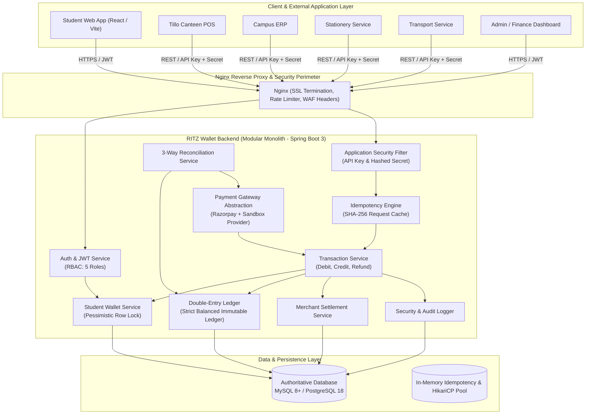

# RITZ Wallet - System Architecture Specification
**Rajalakshmi Institute of Technology (RIT)**

---

## 1. Executive Summary & Core Principle

**RITZ Wallet** is the central digital stored-value and financial accounting platform for the Rajalakshmi Institute of Technology campus ecosystem. It serves as the authoritative financial backend for external campus systems, including:
- **Tillo** (Campus Canteen & Cafeteria POS)
- **Campus ERP** (Tuition, Examination & Lab Fees)
- **Stationery Management** (Bookstore & Printing Facilities)
- **Transport Management** (Bus Passes & Campus Transit)

### Non-Negotiable Core Principle
> **No external campus application is ever permitted to directly modify a student's wallet balance or database records.**  
> Every balance modification must flow through the RITZ Wallet REST API, where it is subjected to authentication, permission checks, row-level concurrency locking, idempotency deduplication, and an immutable double-entry ledger.

---

## 2. High-Level System Architecture



---

## 3. Modular Monolith Architecture

RITZ Wallet is structured as an enterprise-grade modular monolith within `com.rit.token.ritz`. Every domain module maintains explicit boundaries, clean interfaces, and isolated database entities:

| Domain Module | Package | Primary Responsibilities |
|---|---|---|
| **Authentication & RBAC** | `com.rit.token.ritz.auth` | JWT issuance/validation, password hashing (BCrypt), role authorizations (`STUDENT`, `SUPER_ADMIN`, `FINANCE_ADMIN`, `MERCHANT_ADMIN`, `APP_DEVELOPER`). |
| **Student Wallet** | `com.rit.token.ritz.wallet` | Student profile mapping, wallet lifecycle (`ACTIVE`, `SUSPENDED`, `BLOCKED`, `CLOSED`), pessimistic row locking, balance checks. |
| **Double-Entry Ledger** | `com.rit.token.ritz.ledger` | Immutable financial journal, balance sheet accounts (Asset, Liability, Equity, Revenue, Expense), debit/credit balancing verification. |
| **Transaction Processing** | `com.rit.token.ritz.transaction` | Coordinated debit/credit execution, SHA-256 idempotency cache, transaction status state machine. |
| **Payment Gateway** | `com.rit.token.ritz.payment` | Payment provider abstraction (`PaymentGatewayService`), Razorpay Orders API, raw-body HMAC-SHA256 webhook verification, sandbox simulation. |
| **Application Integration** | `com.rit.token.ritz.application` | External app registration, API Key and hashed secret verification (`X-API-KEY` / `X-API-SECRET`), permission scopes (`SCOPE_TRANSACTION_DEBIT`, etc.). |
| **Merchant Management** | `com.rit.token.ritz.merchant` | Merchant registration, category tracking, merchant payable balance aggregation, settlement generation. |
| **Refund Management** | `com.rit.token.ritz.refund` | Refund request tracking, administrative review workflows, compensating transaction processing. |
| **Notification Service** | `com.rit.token.ritz.notification` | Transaction alerts, in-app student and merchant event delivery. |
| **Audit & Governance** | `com.rit.token.ritz.audit` | Non-repudiable audit logs for all sensitive financial and administrative actions. |
| **Financial Reconciliation** | `com.rit.token.ritz.reconciliation` | 3-way automated integrity verification comparing Gateway records, recharge orders, and ledger credits. |
| **Reporting & Export** | `com.rit.token.ritz.report` | Streaming Apache Commons CSV exports of ledgers, transactions, refunds, and settlements. |

---

## 4. Double-Entry Accounting Ledger

Financial integrity is guaranteed through a strictly immutable double-entry ledger.

### Invariant Rules
1. **Zero-Sum Balance**: For every transaction, the sum of debits must exactly equal the sum of credits:
   $$\sum \text{Debits} = \sum \text{Credits}$$
2. **Immutability**: `LedgerEntry` records are write-only. Database update and delete operations are prohibited. Any adjustment or reversal requires a compensating double-entry pair.
3. **Account Classification**:
   - **ASSET**: College bank account / Razorpay nodal holding account (`AST-RZP-SETTLE-001`).
   - **LIABILITY**: Student wallet obligations (`LIAB-WLT-{studentId}`) and Merchant payable accounts (`LIAB-MERCH-{merchantCode}`).
   - **REVENUE**: Platform commission or processing fees.
   - **EXPENSE**: Banking fees, refund adjustments.

### Transaction Accounting Examples

#### A. Student Recharges Wallet with ₹500 (500 Tokens)
*Gateway holds funds; RITZ Wallet owes student stored value.*
- **Debit** `AST-RZP-SETTLE-001` (Asset: Cash held at payment gateway increases): `+500`
- **Credit** `LIAB-WLT-RIT2024001` (Liability: College obligation to student increases): `+500`

#### B. Student Spends 80 Tokens at Tillo Canteen
*College obligation shifts from student to canteen merchant.*
- **Debit** `LIAB-WLT-RIT2024001` (Liability: College obligation to student decreases): `+80`
- **Credit** `LIAB-MERCH-TILLO` (Liability: College payable to Tillo increases): `+80`

#### C. Merchant Settlement (Pay Out ₹10,000 to Tillo Bank Account)
*College clears payable via bank transfer.*
- **Debit** `LIAB-MERCH-TILLO` (Liability: Payable to merchant cleared): `+10,000`
- **Credit** `AST-RZP-SETTLE-001` (Asset: Bank balance decreases): `+10,000`

#### D. Full Refund of 80 Tokens from Tillo to Student
*Compensating journal entry reversing transaction B.*
- **Debit** `LIAB-MERCH-TILLO` (Liability: Payable to merchant deducted): `+80`
- **Credit** `LIAB-WLT-RIT2024001` (Liability: Balance restored to student): `+80`

---

## 5. Concurrency Control & Double-Spend Prevention

To eliminate race conditions when a student initiates simultaneous purchases across multiple cafeteria counters or online ordering terminals:

### 1. Database Row-Level Locking (`PESSIMISTIC_WRITE`)
Wallet balance checks and updates utilize JPA pessimistic write locks:
```sql
SELECT * FROM wallets WHERE student_id = ? FOR UPDATE;
```
When Thread 1 locks wallet `WLT-RIT2024001`, Thread 2 is forced to wait until Thread 1 commits or rolls back. Thread 2 then reads the updated balance. If funds are insufficient, Thread 2 immediately throws `InsufficientFundsException`.

### 2. Deadlock-Free Ledger Account Locking
When transferring funds between two ledger accounts (e.g. Account A and Account B), locks are acquired in strictly deterministic lexicographical order of account codes:
```java
List<String> lockedCodes = Stream.of(fromCode, toCode).sorted().toList();
for (String code : lockedCodes) {
    ledgerAccountRepository.findByAccountCodeForUpdate(code);
}
```
This eliminates circular wait conditions across concurrent operations.

### 3. SHA-256 Idempotency Engine
External applications MUST provide an `Idempotency-Key` header with mutation requests:
1. When a debit request arrives, the backend computes `SHA-256(student_id + amount + reference_id + payload)`.
2. The key and payload hash are queried in `idempotency_records`.
3. If an existing COMPLETED record exists within 24 hours:
   - The transaction is **not re-executed**.
   - The original cached response is returned immediately with HTTP 200.
4. If a concurrent duplicate request arrives while the first is `PROCESSING`, it receives `HTTP 409 Conflict`.

---

## 6. Monetary Representation & Configurable Denominations

- **Zero Floating-Point Representation**: Balances and transaction amounts are stored exclusively as 64-bit BigInt / Long minor units (paise / token minor units) to avoid IEEE 754 precision loss.
- **Dynamic Conversion Rate**: Configured via `TOKEN_EXCHANGE_RATE` (default `1.0` token per ₹1). Minor units are converted explicitly:
  $$\text{Tokens} = \text{Rupees} \times \text{TOKEN\_EXCHANGE\_RATE}$$
  $$\text{Token Minor Units} = \text{Amount in Paise} \times \text{TOKEN\_EXCHANGE\_RATE}$$

---

## 7. Security Architecture

1. **Authentication Channels**:
   - **Human Users (Students & Admins)**: Signed HMAC-SHA256 JWT tokens passed in `Authorization: Bearer <token>`.
   - **External Service Applications (Tillo, ERP)**: Client credentials via HTTP headers:
     - `X-API-KEY: tillo-prod-app-id`
     - `X-API-SECRET: tillo_live_secret_key`
     - Or short-lived application bearer tokens.
2. **Secret Hashing**:
   - Application secrets are never stored in plaintext. They are salted and hashed using BCrypt.
3. **Permission Scoping**:
   - Applications are granted specific scopes (e.g., `SCOPE_TRANSACTION_DEBIT`, `SCOPE_TRANSACTION_READ`). Attempts to call unauthorized operations trigger `HTTP 403 Forbidden`.
4. **Payment Gateway Isolation**:
   - Payment provider logic is isolated behind `PaymentGatewayService`.
   - Razorpay webhook verification uses the **raw HTTP request body** before JSON deserialization to verify the HMAC-SHA256 signature against `RAZORPAY_WEBHOOK_SECRET`.
   - Feature flag `payment.razorpay.enabled` keeps direct gateway calls safely disabled until regulatory approvals are verified.
