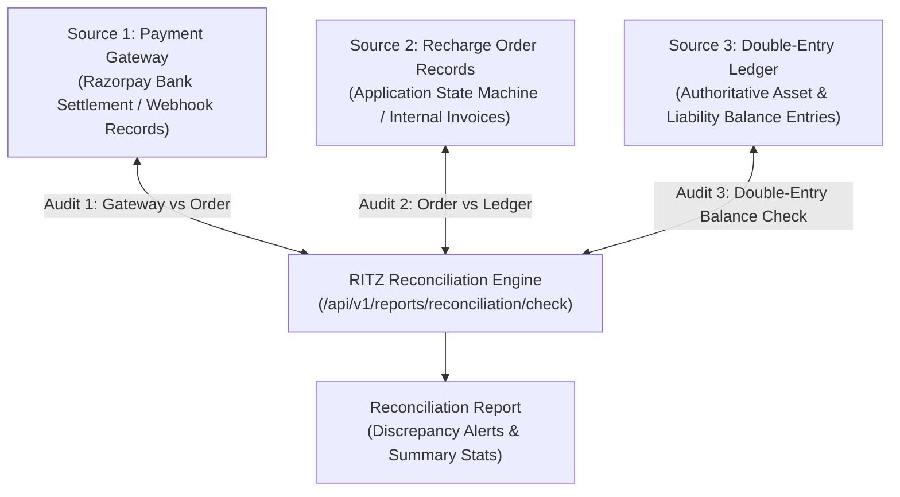

# RITZ Wallet - Financial Reconciliation Guide
**Rajalakshmi Institute of Technology (RIT)**

---

## 1. Overview of 3-Way Reconciliation

In a campus stored-value wallet infrastructure, balance drift between actual banking deposits and student ledger balances cannot be tolerated. RITZ Wallet implements an automated **Three-Way Financial Reconciliation Engine** (`ReconciliationService`) that audits transactions across three independent sources of truth:



---

## 2. The Three Audit Vectors

### Vector 1: Gateway vs. Internal Order Matching
- Compares every `PaymentRecord` received from Razorpay (or Sandbox provider) against the corresponding `RechargeOrder`.
- Checks:
  - Exact currency match (`INR`).
  - Exact amount match (Gateway amount in paise equals Order amount in paise).
  - Status consistency (Captured on Gateway $\iff$ `COMPLETED` on Order).

### Vector 2: Order vs. Double-Entry Ledger Credit Matching
- Every `COMPLETED` recharge order MUST correspond to exactly one balanced double-entry transaction in `ledger_entries`.
- Checks:
  - Ledger transaction reference equals `order.getOrderNumber()`.
  - Debit to Asset account (`AST-RZP-SETTLE-001`) equals credit to Student Liability account (`LIAB-WLT-{studentId}`).
  - Ledger credit amount in token minor units equals order token amount.

### Vector 3: Global Ledger Balancing Invariant
- The reconciliation engine executes an instantaneous sum of all debits vs all credits across the entire journal:
  $$\Delta = \left| \sum \text{debits} - \sum \text{credits} \right|$$
- If $\Delta \neq 0$, the ledger is immediately flagged as **UNBALANCED**, and an administrative alert is generated.

---

## 3. Discrepancy Classification

| Anomaly Class | Root Cause | System Action | Remediation |
|---|---|---|---|
| **ORPHANED_GATEWAY_PAYMENT** | User completed payment on Razorpay checkout, but webhook was dropped or delayed. | Flagged in discrepancy table. | Admin clicks "Process Pending Gateway Record" in Finance Console. |
| **UNCREDITED_ORDER** | Order is marked `COMPLETED` but corresponding ledger entry was interrupted. | Flagged as critical discrepancy. | Reconciliation job triggers auto-healing compensating journal entry. |
| **AMOUNT_MISMATCH** | Gateway reported different captured amount than requested recharge order. | Order placed in `UNDER_REVIEW` state. | Manual review by Finance Administrator. |
| **DUPLICATE_CREDIT_ATTEMPT** | Gateway emitted duplicate webhooks. | Blocked automatically by Idempotency check & gateway payment reference unique constraint. | No action required (logged as prevented duplicate). |

---

## 4. Running Reconciliation

### Via REST API
```http
GET /api/v1/reports/reconciliation/check
Authorization: Bearer <finance_admin_jwt>
```

**Sample Healthy Output:**
```json
{
  "status": "HEALTHY",
  "checked_orders_count": 1420,
  "matched_orders_count": 1420,
  "discrepancies_found": 0,
  "ledger_is_balanced": true,
  "total_ledger_debits": 710000,
  "total_ledger_credits": 710000,
  "net_discrepancy": 0,
  "audit_timestamp": "2026-11-17T06:15:00Z"
}
```

### Via Frontend Finance Console
1. Navigate to `http://localhost:8085` (or live domain).
2. Switch persona or log in as **Finance Admin** (`finance` / `finance123`).
3. Click on the **Reconciliation Console** tab.
4. Click **Run 3-Way Audit**.
5. Download reconciliation audit log as CSV.
